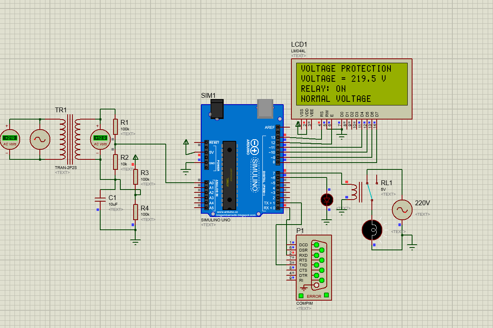
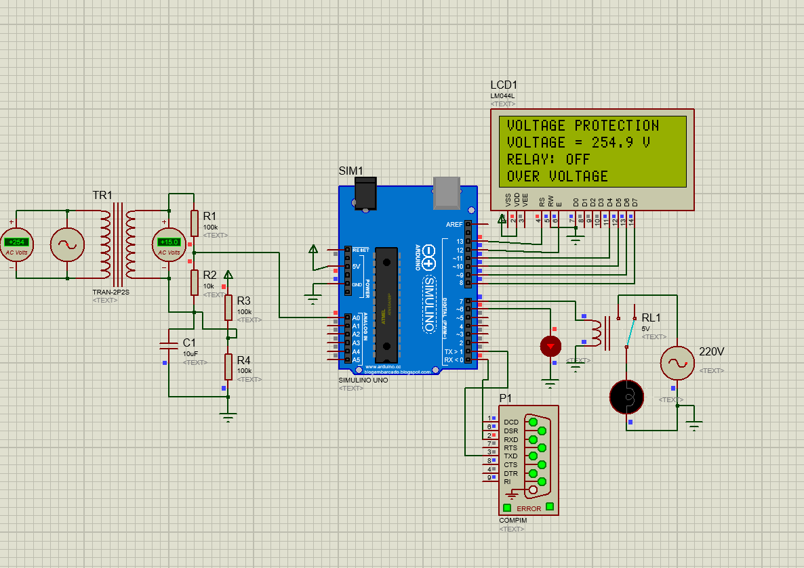
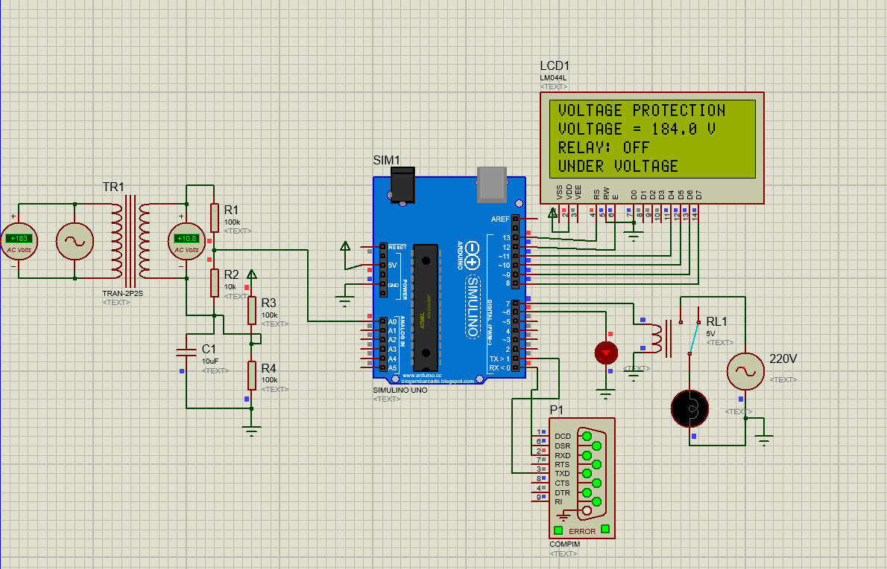

# Over & Under Voltage Protection System


A microcontroller-based protection system that continuously monitors AC mains voltage and **automatically disconnects the load** when the voltage goes above **242 V** (over-voltage) or below **192 V** (under-voltage), protecting appliances from damage.

---

## 📸 System Screenshots

<table>
  <tr>
    <td align="center">
      <br/>
      <b>✅ Normal Voltage</b><br/>
      <sub>197–237 V &nbsp;·&nbsp; Relay ON &nbsp;·&nbsp; Load connected</sub>
    </td>
    <td align="center">
      <br/>
      <b>🔴 Over Voltage</b><br/>
      <sub>&gt; 242 V &nbsp;·&nbsp; Relay OFF &nbsp;·&nbsp; Load disconnected</sub>
    </td>
    <td align="center">
      <br/>
      <b>🔵 Under Voltage</b><br/>
      <sub>&lt; 192 V &nbsp;·&nbsp; Relay OFF &nbsp;·&nbsp; Load disconnected</sub>
    </td>
  </tr>
</table>

---

## 📋 Table of Contents

- [Overview](#-overview)
- [Hardware](#-hardware)
- [Voltage Thresholds](#-voltage-thresholds)
- [Repository Structure](#-repository-structure)
- [Getting Started](#-getting-started)
- [Simulation](#-simulation)
- [Test Evidence](#-test-evidence)
- [Design Document](#-design-document)
- [License](#-license)

---

## 🔍 Overview

| Parameter | Value |
|-----------|-------|
| Microcontroller | Arduino Uno (ATmega328P) |
| Voltage range | 192 V – 242 V AC |
| Hysteresis | ±5 V |
| Display | 20×4 LCD (LiquidCrystal, 4-bit mode) |
| Output | 5V relay module + LED indicator |
| Sensing library | [EmonLib](https://github.com/openenergymonitor/EmonLib) |
| Simulation tool | Proteus 8 |

---

## 🔧 Hardware

| Component | Specification |
|-----------|---------------|
| Arduino Uno | ATmega328P, 5V, 16 MHz |
| Step-down Transformer | 230V AC → 9V AC |
| Voltage Sensor | ZMPT101B module / resistor divider |
| LCD Display | 20×4 HD44780 |
| Relay Module | 5V, 10A/250VAC |
| LED | 5mm red LED + 220Ω resistor |

### Pin Mapping

| Function | Arduino Pin |
|----------|-------------|
| Voltage sense (analog) | A0 |
| Relay control | D7 |
| LED indicator | D6 |
| LCD RS | D13 |
| LCD E | D12 |
| LCD D4 | D11 |
| LCD D5 | D10 |
| LCD D6 | D9 |
| LCD D7 | D8 |

---

## ⚡ Voltage Thresholds

```
< 192 V     → UNDER VOLTAGE  → Relay OFF, LED ON
192–197 V   → WAITING...     → Relay OFF (hysteresis hold-off)
197–237 V   → NORMAL VOLTAGE → Relay ON,  LED OFF
237–242 V   → WAITING...     → Relay OFF (hysteresis hold-off)
> 242 V     → OVER VOLTAGE   → Relay OFF, LED ON
```

---

## 📁 Repository Structure

```
over-under-voltage-protection/
├── src/                        # Firmware source code
│   ├── voltage_protection.ino  # Arduino sketch (main firmware)
│   └── voltage_protection.ino.hex  # Compiled HEX for Proteus simulation
├── design_document.pdf         # Full project design document (report)
├── schematics/                 # Schematic & block diagram
│   └── block_diagram.md        # ASCII block diagram + signal flow table
├── test_evidence/              # Test screenshots & results
│   ├── README.md               # Test results summary table
│   ├── over_voltage.png        # LCD showing OVER VOLTAGE state
│   ├── safe.png                # LCD showing NORMAL VOLTAGE state
│   └── under_voltage.png       # LCD showing UNDER VOLTAGE state
├── project_files/              # Simulation project files
│   ├── Circuit.pdsprj          # Proteus 8 project file
│   └── README.md               # How to run the simulation
└── README.md                   # ← You are here
```

---

## 🚀 Getting Started

### Prerequisites

- [Arduino IDE](https://www.arduino.cc/en/software) 1.8+
- [EmonLib](https://github.com/openenergymonitor/EmonLib) library installed in Arduino IDE
- Arduino LiquidCrystal library (bundled with Arduino IDE)

### Flash Firmware

```bash
# Clone the repository
git clone https://github.com/a1vi/over-under-voltage-protection.git
cd over-under-voltage-protection

# Open in Arduino IDE
start src/voltage_protection.ino
```

1. Select **Board → Arduino Uno** and the correct COM port.
2. Click **Upload**.

---

## 🖥 Simulation

Open **Proteus 8** and load `project_files/Circuit.pdsprj`.  
Point the virtual Arduino to `src/voltage_protection.ino.hex`.  
Press **F9** to run; vary the AC source to test all voltage zones.

See [`project_files/README.md`](project_files/README.md) for detailed steps.

---

## 🧪 Test Evidence

All three system states captured from Proteus 8 simulation:

| Normal Voltage | Over Voltage | Under Voltage |
|:-:|:-:|:-:|
|  |  |  |
| Relay **ON** · Load connected | Relay **OFF** · Tripped high | Relay **OFF** · Tripped low |

Full test results & pass/fail log: [`test_evidence/README.md`](test_evidence/README.md)

---

## 📄 Design Document

The complete project report (circuit explanation, theory, calculations, and results) is available as [`design_document.pdf`](design_document.pdf).

---

## 📝 License

This project is licensed under the **MIT License** — see the [LICENSE](LICENSE) file for details.
